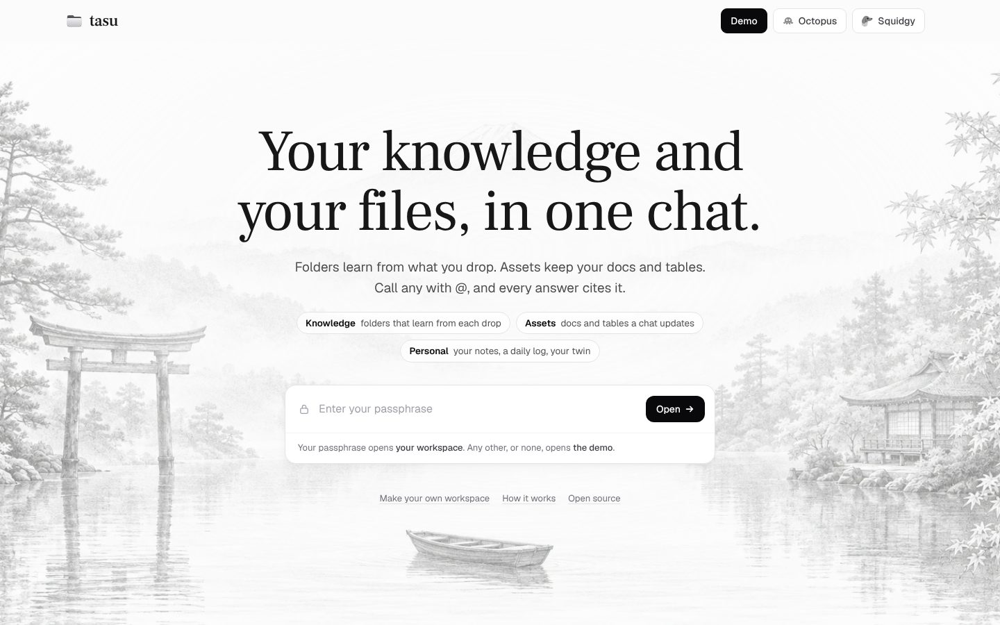
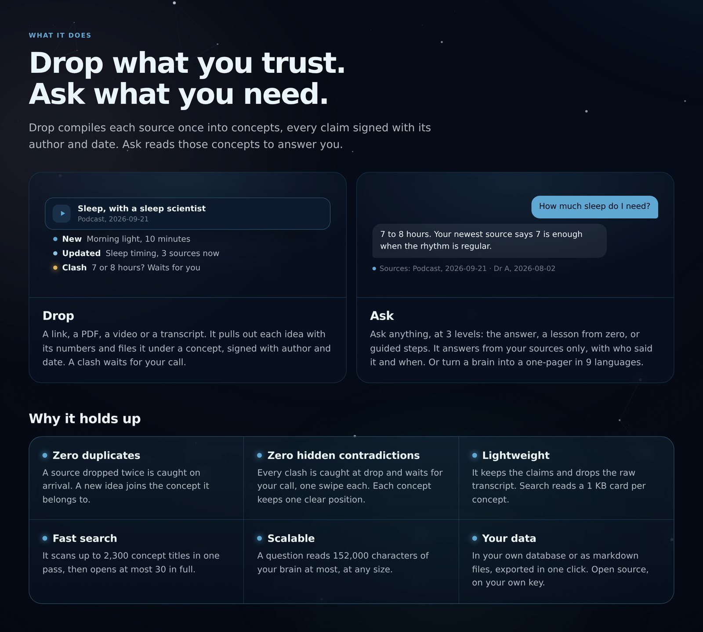
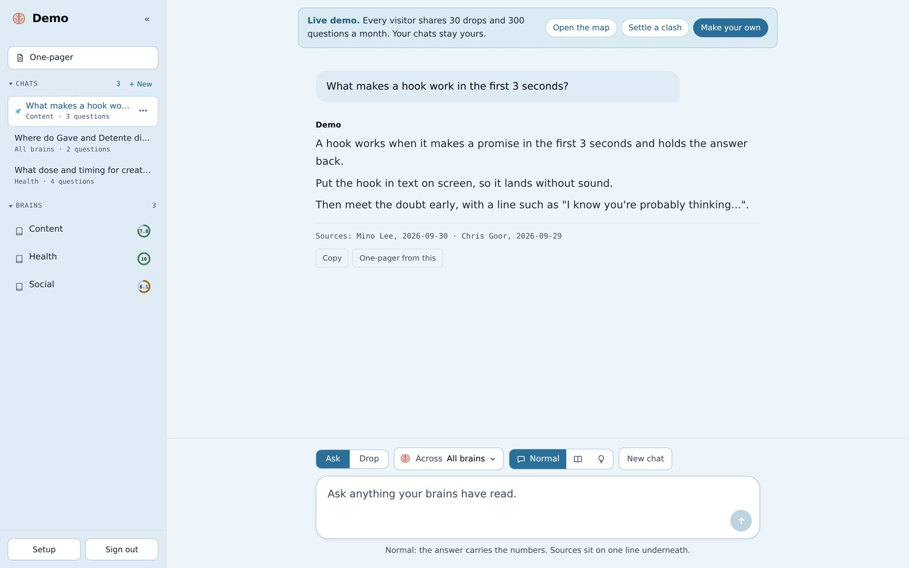
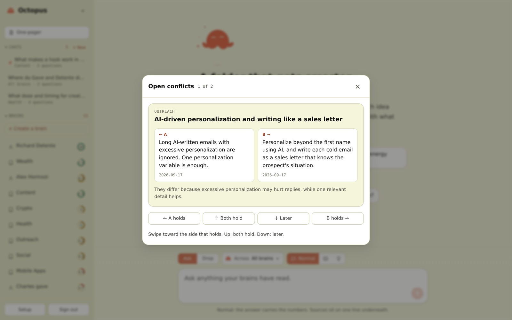
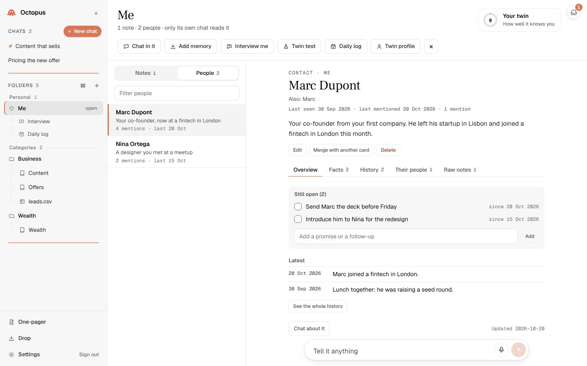

<div align="center">


# Tasu

**Files what you read, and answers from it.**

Drop a talk, a PDF or a link. Each idea lands in a folder with its author and date. Ask, and every answer cites them.

[**Open tasu.ai**](https://tasu.ai) &nbsp;·&nbsp; [Read the white paper](https://tasu.ai/about) &nbsp;·&nbsp; [Run your own](#run-your-own)


<br><br>



</div>

<br>

[What it does](#what-it-does) · [Why it holds up](#why-it-holds-up) · [Compared](#compared) · [Inside the app](#inside-the-app) · [Personal folder](#the-personal-folder-alpha) · [Assets](#assets) · [Workspaces](#workspaces) · [Run your own](#run-your-own) · [Work on it](#work-on-it)

## What it does



**Drop.** A link, a PDF, a Word file, a video or a transcript. Each idea is filed under a concept with its numbers, signed with author and date. A claim that clashes with what you hold waits for your call.

**Ask.** Ask anything, at 3 levels: the answer, a lesson from zero, or guided steps. It answers from your sources only, and the last line names who said it and when.

Drop compiles each source once. Ask reads what was compiled. The [white paper](https://tasu.ai/about) walks through both, step by step.

## Why it holds up

| | |
|---|---|
| **Zero duplicates** | A source dropped twice is caught on arrival. A new idea joins the concept it belongs to. |
| **Zero hidden contradictions** | Every clash is caught at drop and waits for your call, one swipe each. Each concept keeps one position. |
| **Light** | It keeps the claims and drops the raw transcript. Search reads a 1 KB card per concept. |
| **Fast search** | The router reads the 120 titles nearest in meaning, then opens 30 concepts at most. 1,000 concepts cost it 1,750 tokens, down from 12,700. |
| **Flat cost** | A question reads 69,000 characters at most, at any size. A thank-you reads none. |
| **Your data** | In your own database or as markdown files. Exported in one click, restored in one. Open source, on your own key. |

## Compared

A classic AI chat answers from its training data. Karpathy's LLM wiki compiles your files into pages. Tasu compiles them into **positions**, each backed by dated evidence you can open, and asks you when two sources clash.

| | Classic AI chat | Karpathy's LLM wiki | **Tasu** |
|---|---|---|---|
| Answers from | Its training data | Your files, as pages | **Your sources, as positions with their evidence** |
| Proof | None, or a link it made up | A summary per page | **Author and date on every claim** |
| When sources disagree | Blended into one answer | Left side by side | **Flagged at each drop; you rule in a swipe** |
| New information | Frozen at the training date | Added when you run the agent | **Filed the day you drop it** |
| Whose view | An average of the internet | Your topics | **One folder per subject, per expert, or for you** |
| Setup | A chat box | Scripts, Obsidian, a coding agent | **A web page, or an app on phone and desktop** |
| What you get | A reply | Pages, slides, charts | **Answers at 3 levels, one-pagers in 9 languages, a health score** |

## Inside the app

<table>
<tr>
<td width="33%" valign="top">

<br><b>Answers with receipts.</b> Every line comes from a source you fed it. The sources line names each author and date. Newer evidence wins on the same question.
</td>
<td width="33%" valign="top">

<br><b>It argues back.</b> A source that contradicts what you hold waits for your call. Swipe: A holds, B holds, or both. The position is rewritten from all its evidence.
</td>
<td width="33%" valign="top">

<br><b>It learns you.</b> A personal folder files what you tell it as dated notes, and says what it filed. Your other folders never read it.
</td>
</tr>
</table>

### Chat

- **Pick the folders.** Tick as many as you like in the side panel, or type @ to tag up to 4 in any chat. The answer says what it read: "Read @Pricing".
- **Talk as long as you want.** Whisper large-v3 turbo writes what you say, through OpenRouter on the same key: punctuation and names included, in 27 languages or any with Detect, about $0.04 an hour of talking. The words arrive a piece at a time, about every 20 seconds, cut at a pause; a pause costs nothing. One strip over the bar shows who writes it, "Whisper · French", and for how long. Done keeps all of it, Cancel keeps nothing. The browser's free voice input stays one tap away in Settings.
- **Follow-ups that hold.** An answer remembers the concepts it read, so "and the second one?" finds what it named.
- **Ask twice, pay once.** The same question on unchanged folders returns the saved answer for 14 days, with no model call.
- **It runs in the background.** Open another chat, a folder or Drop: the answer lands in its own chat, and the inbox counts it.
- **Errors say what to do.** Try again resends the message in place. Send feedback mails the error, 5 an hour at most.
- **Chats stay.** Rename them and pin up to 5. The side panel shows 5, and See all opens the rest. Old ones clear after 30 days.

### Folders

- **A drop keeps everything.** Every number, date and name of the source is checked against what was filed, and anything missing goes in word for word. The card says it: "All of it kept: 7,020 words, 145 numbers, dates and names, 23 topics, filed into 18 concepts".
- **A folder, open.** Its scope, counts, health and next move, then every concept, newest first. Chat in it, drop into it, rename it, merge it into another, or delete it with its Delete button. Delete first counts what goes: "Content holds 42 concepts and 12 sources, 9 of them only here".
- **Every drop grows the graph.** Each new idea links to its 6 nearest in meaning, in any language: needs, causes, supports, contradicts or example. Folders sort themselves into topics.
- **What follows.** Two linked ideas from different folders can add up to a third. A drop writes up to 5, marked as Tasu's own conclusion.
- **One page, any shape.** A folder or a question becomes a summary, a quiz, a deep dive or use cases, in 9 languages.
- **Decisions, with a call ready.** Clashes, concepts filed twice, titles not in English, empty positions and the same person on two cards sit in one list, grouped by folder. Each has a suggested call and its reason: "B holds. The later claim: September 2026 over February 2026". Accept one, or all in one tap.
- **Audit.** After 50 new sources, a folder is audited on its own the next time you open Tasu. The personal folder asks every 7 days.

### Inbox

A bubble at the top right counts what waits for you: answers ready, questions on their way, a drop in progress, the weekly audit, the decisions, and what is still open with your people. A ring turns on it while something runs.

### Settings

| | |
|---|---|
| **One-pager** | A folder, a group or a question as bullets on one page. First in Settings. |
| **Model** | GLM 5.3 Flash by default, for the whole workspace. Or a list of favourites: each morning the cheapest runs, when it is at least 10% cheaper. |
| **Answers** | Short reads the 12 best concepts, for about a third less a question. Long reads up to 30. Educational and Learning answers read in full either way. |
| **App** | Installs Tasu on the home screen or the dock. See [Install as an app](#install-as-an-app). |
| **Appearance** | System, Light or Dark, kept in this browser. |
| **Languages** | The language of answers (as you write, or English). Voice: Whisper (any length, any language) or the browser (free, 2 minutes). The mic language: 27, or Detect. |
| **Cost** | This month in dollars for each kind of work: folder chat, personal chat, assets, drops, upkeep, one-pagers and voice, and last month in all. |
| **Export, Restore** | Every folder as one markdown file, and read back in one step: what is missing returns, what is there stays. |
| **Audit, Look, Passphrase, Share** | Audits and clashes; a logo, an accent and a page colour; a new passphrase that signs others out; a folder shared with another workspace. |

### Install as an app

Tasu installs from the browser. The app stores play no part.

| Device | Where to tap |
|---|---|
| iPhone, iPad | Safari, Share, then Add to Home Screen |
| Android | Chrome menu, then Install app |
| Mac | Safari, File, then Add to Dock |
| Windows, Mac, Linux | Chrome or Edge, the install icon in the address bar |

Settings, App opens the browser's own prompt where there is one, and shows these steps everywhere else. Installed, Tasu opens in a window of its own, on the workspace used last, with the Tasu icon.

## The personal folder <sup>alpha</sup>

A third kind of folder, next to subjects and experts. You talk to it, and it keeps what you said.

- **It files your words.** Each message becomes up to 3 notes, each dated and signed "You". A change of mind rewrites the note and keeps the old view with its date.
- **Add memory.** Paste what another assistant knows about you, or add a PDF, Word, text or JSON file. It is checked like a drop, and the result says "All of it kept".
- **It answers as your twin.** "I want Porto in 2027." It decides with your own rules and names them: "I'd pass. I never trade learning for 20% more salary."
- **It calls your other folders.** When one bears on what you said, it brings it up: "your Health folder says 3 to 5 g a day".
- **A person is a folder.** Overview, Facts, History a year at a time, Their people, and Raw notes word for word. A changed fact keeps the old one with the day it ended.
- **Still open, in the inbox.** The 3 oldest promises and follow-ups from your people, each with a tick. Comment under a line, and one send updates every line you commented.
- **It interviews you.** 335 quick questions in 17 chapters, life story first, each under 30 seconds. It skips what your notes already answer, and ends at 100%.
- **Your twin, tested.** 5 situations built from your notes. Your twin replies first, then you do, and the two are compared on the decision, the facts and the voice. Your replies go into your notes.
- **Any language in, English kept.** Write or talk in any language. Notes are kept in English, your own words beside each line.
- **Private.** Its own chat is its only reader.

## Assets

Documents, tables, pages and web pages you keep. Any chat calls one with @, as it calls a folder.

- **Add** Word, PDF, text, Markdown, HTML, Excel or CSV files of up to 30MB, read in your browser. Or a link: the page is read and kept, up to 60,000 characters, and read again in one tap. Or a blank document, table or page.
- **Call it with @.** "@invest-assets.csv what are the best 4 lines?" A table of up to 120,000 characters (about 300 rows of 30 columns) is read whole; a bigger one, up to 40,000 rows, by a filter and totals run over every row. A document of up to 60,000 characters (about 20 pages) is read whole; a longer one, up to 4,000 pages, by the 8 sections that bear on the question. Up to 4 assets and folders in one message.
- **Nothing changes without you.** A chat proposes a change with the words before and after, or a new asset with what it will hold. Apply, Turn down, then Undo.
- **Versions.** A file dropped under a name an asset holds becomes its new version. The one before is kept: Undo brings it back.
- **Cost, on the default model (GLM 5.3 Flash, $0.035 a million tokens read, $0.90 written).** A question on a 300-row table reads about 40,000 tokens: $0.0014, plus about $0.0005 for the answer. A proposed page or table of 3,000 tokens adds $0.003. Reading a 100-page PDF in costs about $0.005; a table or a link, nothing. Counted under Assets in Cost.
- **See it.** A document's pages, a table's grid, a page as it renders or as code. Download a document as Markdown, PDF or a web page, a table as Excel, CSV or Markdown.
- **Projects from before.** A line in Assets turns them into assets, after a list of what each becomes: every file with all it holds, and the Brief, where it stood and what it kept as one document, Notes of the project. Its last 4 chat exchanges go. Nothing moves before you confirm.

## Workspaces

A workspace holds its own folders and chats, apart from every other.

| | Octopus, Squidgy | The demo | Your own |
|---|---|---|---|
| Whose | The builder's, and someone's | Anyone's | Yours |
| Enter | Its own page, passphrase on top | One click | Made on the landing |
| Model calls paid by | The deployment's key | A separate demo key | **Your OpenRouter key** |
| Limits | None | 30 drops and 300 questions a month, shared | Your key's own |
| New folders, personal folders | Yes | No | Yes |

- **A workspace for someone, on your key.** `npx convex run admin:makeWorkspace "{name:'PandAAAHH',pass:'ABC12345'}" --prod` makes an empty workspace behind that passphrase. Its owner changes the passphrase from Settings.
- **Share a folder.** One folder, two workspaces, one copy. A drop in either fills both, and a clash ruled in one is ruled in both. Shared with the demo, visitors can only ask it. A personal folder stays private.
- **Your key stays yours.** It is checked once with OpenRouter, kept in your browser, and sent only with the calls that need a model. Sign out forgets it.

## Run your own

A Convex deployment holds the data. Any static host serves `app/`.

```bash
git clone https://github.com/jlasne/brain && cd brain && npm install
npx convex dev
npx convex env set OPENROUTER_API_KEY sk-or-... --prod
npx convex deploy
npx convex run admin:setPass '{"space":"octopus","pass":"at least 8 characters"}' --prod
npx convex run admin:makeDemo '{"copy":["health","content","social"]}' --prod
```

Point `window.OCTOPUS_API` in the pages under `app/` at your deployment's `.convex.site` address. In Windows PowerShell, write each argument as `"{space:'octopus',pass:'...'}"`.

<details>
<summary><b>Environment variables</b></summary>

<br>

| Variable | What it does |
|---|---|
| `OPENROUTER_API_KEY` | Pays for model calls in the owner's workspaces. Required. |
| `DEMO_OPENROUTER_API_KEY` | A separate key for the demo, so its spend shows apart. Falls back to the one above. |
| `DEMO_MONTHLY_DROPS` | Drops the demo takes in 30 days, all visitors together. Default 30. |
| `DEMO_MONTHLY_ASKS` | Questions the demo answers in 30 days. Default 300. |
| `DEMO_MONTHLY_STEPS` | Reads, plans and stores the demo makes in 30 days. Default 20 a drop. |
| `SUPADATA_API_KEY` | Fetches YouTube captions from a bare link. Without it, a video link asks for the transcript. |
| `SUPADATA_MODE` | `auto` transcribes videos that have no captions, at 2 credits a minute. |
| `OTHERS_FETCH_DAY` | Pages and transcripts fetched for every other workspace together, a day. Default 100, on top of 20 each. |
| `RESEND_API_KEY`, `MAIL_FROM` | Mail one-pagers from the owner's workspaces. |
| `DIGEST_TO` | Where the Monday digest goes: the week's sources, new concepts and open conflicts. |
| `FEEDBACK_TO` | Where Send feedback mails an error. Unset, it goes to `DIGEST_TO`. |

`admin:copyBrain '{"slug":"...","space":"demo"}'` adds one more folder to the demo. `digest:send '{"dry":true}'` previews the digest.

</details>

<details>
<summary><b>Claude</b></summary>

<br>

**Connector.** In an owner's workspace, Settings gives an MCP address. Paste it into Claude, ChatGPT or any MCP client: it reads and feeds that workspace's folders, and the client's own model does the thinking. `/doc` has the steps.

**Claude Code.** Copy `skill/brain/` into `~/.claude/skills/brain/`. The folders are then plain markdown files under `brains/`, following [the 41 rules](docs/PROTOCOL.md).

</details>

<details>
<summary><b>Security</b></summary>

<br>

- Passphrases are stored as salted SHA-256 hashes, one per workspace. 8 wrong guesses close that door for an hour, and each guess is counted before it is checked.
- Every route checks the session before it reads a folder or calls a model.
- The demo runs on the default model within its monthly limits. Creating, renaming and connecting folders are closed to it.
- A personal folder is read by its own chat only. Every other reader loads the workspace without it.
- The server keeps only what was extracted: a visitor's OpenRouter key and raw transcripts stay out of it.
- Linking runs later on the deployment's key, so it stays off in the demo and in a workspace on its own key.
- The Word reader loads from cdnjs only if its bytes match the published hash.

</details>

## Work on it

The app's source sits in `web/chat/`, one file a screen. `npm run build` joins it into `app/chat.html`, the one file the host serves. Commit both.

```bash
npm run build     # web/chat into app/chat.html
npm run check     # the build first, then 1869 checks
npm run deploy    # the server, to Convex
```

```
app/            the landing, the built app, the white paper, the install manifest and icons
web/chat/       the app's source: page.html, 10 stylesheets and 19 scripts, one a screen
convex/         the server: routes, store, drop, one-pager, health, conflicts, personal, assets
scripts/        the build and the checks, the app driven in a real browser included
docs/           the 41 rules (PROTOCOL.md), the server build (SERVER.md), the screenshots
skill/brain/    the same behaviour, as a Claude Code skill
templates/      the markdown shape of a folder
```

`npm run check` runs 1869 checks: the build matches its source, the pages parse and bind, the install manifest and its icons, the Claude connector, the store and its workspaces, one-pagers, asking, linking, the health score, the personal folder, assets, and the app itself in a real browser at 9 screen sizes.

<br>

<div align="center">

Built in September 2026 by [Jeremy Lasne](https://www.jeremylasne.com) for The Build Games. MIT license.

</div>
